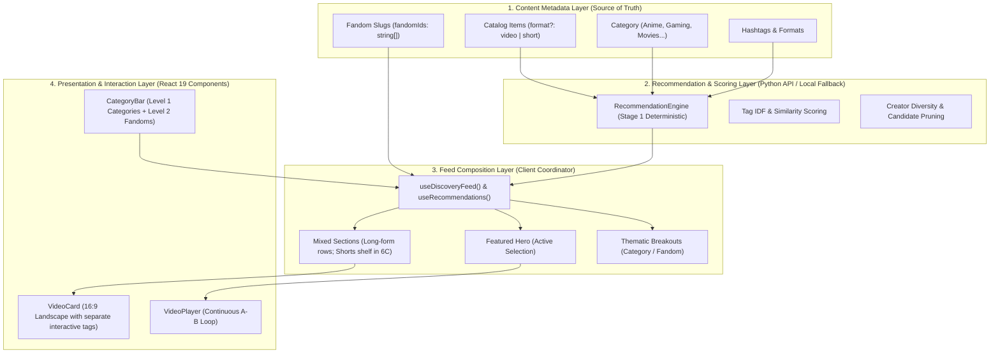

# Lolixco Mission 6: Category, Fandom & Topic Discovery Architecture

**Date:** 2026-10-18  
**Author:** Antigravity (Lead Product Researcher & Integration Architect)  
**Milestone:** Mission 6 (Stage 1 Research & Mission 6B Foundation Implementation)  
**Status:** Implemented & Verified in `feat/mission6b-fandom-navigation`  

---

## 1. Core Architectural Separation: The 4-Layer Discovery Model

To organize curated long-form videos, upcoming vertical Shorts, categories, fandoms, hashtags, and recommendations without architectural entanglements, Lolixco implements a clean **4-Layer Discovery Model**:



### Architectural Principles
1. **Zero Recommendation Engine Redesign:** The Python engine in `server/recsys/` provides deterministic heuristic ranking (not a trained neural model). It filters by category and required tags (`tags_all`). Fandom filtering in Mission 6B is handled cleanly as a structured client-side metadata constraint.
2. **Format-Aware Presentation:** Long-form edits (16:9) and future Shorts (9:16) share typed metadata foundations (`ContentFormat`), but Shorts presentation is deferred to Mission 6C.
3. **Account-Free Alignment:** Public UI is 100% free of sign-in, member preview, creator names, or public engagement counters.

---

## 2. Content Schema & Metadata Foundation

### Typed Schema (`src/types/content.ts`)

```typescript
export type ContentFormat = "video" | "short";

export type CanonicalCategory =
  | "Anime"
  | "Movies"
  | "Series"
  | "Multifandom"
  | "Gaming"
  | "Phonk";

export type LegacyCategory = "Cinematic";

export type ContentCategory = CanonicalCategory | LegacyCategory;
export type BrowsingCategory = "All" | ContentCategory;

export interface PublicMediaMetadata {
  id: number;
  format: ContentFormat;
  title: string;
  description: string;
  category: ContentCategory;
  fandomIds?: string[];
  tags: string[];
  poster: string;
  source: string;
  duration: string;
}

export interface EditorialMetadata {
  curatorNotes?: string;
  reviewStatus?: "draft" | "reviewed" | "published";
  originalAspectRatio?: "16:9" | "9:16" | "4:3" | "2.39:1";
  legacyCreatorId?: string;
}
```

### Key Schema Characteristics
- **Multi-Fandom Support:** Uses `fandomIds: string[]` (array of stable slug identifiers), never a single brittle display string.
- **Stable Slugs:** Separates stable canonical slugs (e.g. `jujutsu-kaisen`, `valorant`) from human-readable labels (`Jujutsu Kaisen`, `Valorant`) and hashtags (`#jjk`, `#valorant`).
- **Separation of Concerns:** Public metadata presented to visitors contains zero creator names or private rankings. Internal recommendation engine fields remain preserved in Python types and catalog snapshot.
- **Cinematic Preservation:** The demo items assigned to category `"Cinematic"` (IDs 0, 6, and 12 out of the 17 items distributed across Cinematic, Gaming, Anime, Movies, Series, and Phonk) keep their category verbatim. Cinematic is **NOT** aliased to `Movies` or `Multifandom`. It remains discoverable under `"Cinematic"` and `"All"`.

---

## 3. Explicit Fandom Registry (`src/data/fandoms.ts`)

Instead of hardcoding custom rendering logic for every franchise, Lolixco uses a scalable, explicit Fandom Registry:

```typescript
export interface Fandom {
  id: string;             // Canonical slug, e.g. "jujutsu-kaisen"
  title: string;          // Human-readable display label, e.g. "Jujutsu Kaisen"
  categories: CanonicalCategory[]; // Category relationships, e.g. ["Anime"]
  description?: string;
}

export const FANDOM_REGISTRY: readonly Fandom[] = [
  { id: "jujutsu-kaisen", title: "Jujutsu Kaisen", categories: ["Anime"] },
  { id: "demon-slayer", title: "Demon Slayer", categories: ["Anime"] },
  { id: "spider-man", title: "Spider-Man", categories: ["Movies"] },
  { id: "valorant", title: "Valorant", categories: ["Gaming"] },
  { id: "doom", title: "Doom", categories: ["Gaming"] },
];
```

### Navigation Rules
- **Category Selection:** Selecting a primary category (e.g. `Gaming`) immediately reveals Level 2 sub-chips (`All Gaming`, `Valorant`, `Doom`).
- **Fandom Selection:** Selecting `Valorant` filters the catalog to edits where `fandomIds` includes `"valorant"`.
- **Incompatible Category Switches:** Changing category to `Anime` immediately invalidates and clears the incompatible `valorant` fandom filter.
- **Honest Empty States:** Selecting a fandom with zero catalog edits (e.g. `Valorant` in current demo dataset) displays an honest empty state with a "Clear fandom filter" button. No fake franchise edits or simulated media are fabricated.

---

## 4. URL State & Browser History Synchronization

Category, fandom, and search query state are synchronized with URL query parameters (`?category=...&fandom=...&q=...`) without external routing libraries:

- **Deliberate Navigation:** Category and fandom changes use `window.history.pushState` to create navigable history entries.
- **Live Search Keystrokes:** Typing in the search input uses `window.history.replaceState` to prevent polluting browser history with single-character states. Tag chip clicks use `pushState`.
- **Browser Back / Forward:** A `popstate` listener synchronizes URL parameter changes back into React state.
- **Direct Link Support:** Direct visits with encoded URL parameters (e.g. `?category=Gaming&fandom=valorant`) parse and apply valid states on initial load. Invalid categories or incompatible fandoms fall back safely to defaults.

---

## 5. Search Engine & Hashtag Interaction

- **Scoring Weights:** Reallocated without creator metadata:
  - Hashtag mode: `hashtag: 0.40, title: 0.30, category: 0.15, description: 0.15, creator: 0.00` (Sum = 1.00).
  - Non-hashtag mode: `title: 0.50, category: 0.25, description: 0.25, creator: 0.00` (Sum = 1.00).
- **Creator Privacy:** Query terms do not match internal creator names, preventing hidden metadata from leaking.
- **Separate Interactive Controls:** `VideoCard` renders an `<article>` container with a `<button class="card-watch-trigger">` and sibling `<button class="tag-chip">` elements. Clicking a tag filters by `#tag` without triggering video selection or playback.

---

## 6. Recommendation Engine Compatibility

- **Preservation of Mission 5:**
  - Python ranking engine (`server/recsys/engine.py`), catalog snapshot (`server/recsys/catalog_snapshot.json`), and API contracts remain untouched.
  - Recsys API receives only valid canonical categories (`Anime`, `Gaming`, `Movies`, `Series`, `Phonk`, `Cinematic`). Unsupported categories like `Multifandom` are never passed to the current backend.
  - Active video suppression, deterministic offline fallback, and request guards are fully preserved.

---

## 7. Known Limitations & Next Milestones

1. **Shorts System (Mission 6C):**
   - The dedicated 9:16 Shorts shelf, vertical portrait card, and portrait viewing player are deferred to Mission 6C.
   - Metadata foundation (`format?: ContentFormat`) is prepared, but no fake Shorts or portrait player modifications are included in 6B.
2. **Library Ingestion (Mission 7):**
   - The current catalog contains 17 demo edits. Real curated edits for franchises (Jujutsu Kaisen, Valorant, Spider-Man, etc.) will be added when real video assets are provided.
3. **Local Integration Scope:**
   - Validated for local frontend integration and deterministic recsys backend serving. Production cloud deployment infrastructure is outside this milestone.
