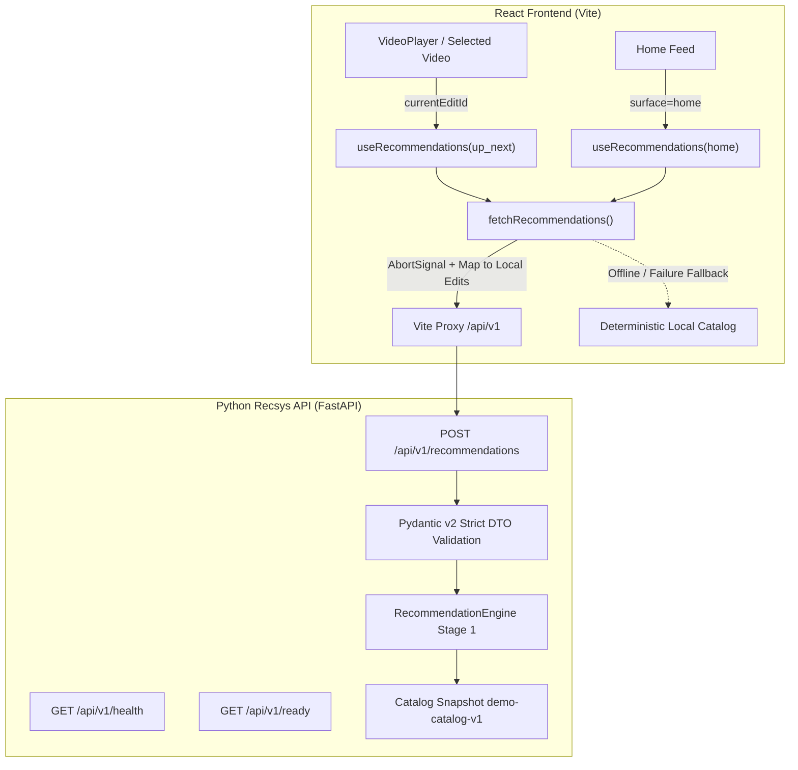

# Lolixco Mission 5: Recommendation API & Frontend Integration

**Status:** Ready for Independent Code Review  
**Branch:** `feat/mission5-recsys-integration`  
**Base:** `46731465c5bcf0c3c79322dac585b79193390bcc` (origin/main)  
**Date:** 2026-10-17  

---

## 1. Architecture Overview

Mission 5 bridges Lolixco's React frontend with the deterministic Python recommendation engine delivered in Mission 4.



### Key Architectural Decisions
1. **Lightweight FastAPI Service:** Built on FastAPI 0.115 and Pydantic v2. Reuses `RecommendationEngine` and `Catalog` directly without duplicating any ranking logic.
2. **Local Asset Preservation via ID Mapping:** The frontend maintains validated local asset paths (`poster`, `source`, `duration`) with Vite base-path awareness. Server recommendations return strict numeric `edit_id` values, which the client maps directly to local `Edit` objects. Server asset paths are never blindly trusted.
3. **Deterministic Offline Fallback:** If the backend is unreachable or disabled, the frontend seamlessly renders deterministic fallback recommendations (`source: "fallback"`), avoiding blank screens, layout thrashing, or console crashes.
4. **Race-Condition & Stale-Response Protection:** `useRecommendations` utilizes `AbortController` and sequential request counters (`seqRef`). Rapid video switching immediately cancels prior in-flight requests.
5. **Zero-CORS Local Dev Proxy:** Vite dev server proxies `/api` requests to `127.0.0.1:8000`, eliminating CORS overhead during local development while allowing direct cross-origin requests when configured.

---

## 2. API Contract Specification (v1)

### Endpoints

| Method | Endpoint | Description | Status Code |
| :--- | :--- | :--- | :--- |
| `GET` | `/api/v1/health` | Process liveness probe | 200 OK |
| `GET` | `/api/v1/ready` | Catalog and engine readiness | 200 OK / 503 Unavailable |
| `POST` | `/api/v1/recommendations` | Deterministic recommendation ranking | 200 OK / 404 / 422 / 503 |

### Request DTO (`POST /api/v1/recommendations`)
```json
{
  "surface": "up_next",
  "current_edit_id": 0,
  "limit": 4,
  "mode": "auto",
  "filters": {
    "category": "Cinematic",
    "tags_all": ["cinematic", "landscape"]
  },
  "exclude_edit_ids": [1, 2],
  "context": {
    "history": [
      {
        "edit_id": 6,
        "unique_watch_ms": 12000,
        "occurred_at": "2026-10-17T12:00:00Z"
      }
    ]
  }
}
```

- `surface`: `"home"` | `"up_next"` (required).
- `current_edit_id`: Strict integer $\ge 0$. Required when `surface="up_next"`. Unknown ID returns 404.
- `limit`: Strict integer $1 \le \text{limit} \le 50$. Default `12`.
- `mode`: `"auto"` (default), `"baseline"`, or `"neural"` (returns 503; neural models deferred to future milestones).
- `filters.category`: Optional canonical category (`Cinematic`, `Gaming`, `Anime`, `Movies`, `Series`, `Phonk`, case-insensitive). Invalid values return 422.
- `filters.tags_all`: Optional list of strings. Enforces strict all-tags-match filtering on candidates before ranking. Tags are trimmed, lowercased, and deduplicated (max 10 tags, 1–64 characters each). If valid tags match no items, an empty recommendation list is returned. Malformed tags return 422.
- `exclude_edit_ids`: List of strict integers $\ge 0$ (max 200 items).
- `context.history`: List of watch history objects (max 50 items).
  - `edit_id`: Strict integer $\ge 0$.
  - `unique_watch_ms`: Strict integer $0 \le \text{unique_watch_ms} \le 3{,}600{,}000$ (bounded to 1 hour max session watch time).
  - `occurred_at`: Strict RFC3339 / ISO 8601 UTC-aware timestamp string with explicit timezone offset (e.g. `2026-10-17T12:00:00Z` or `+00:00`). Naive timestamps or malformed strings return 422.
- `extra = "forbid"`: Rejects unknown fields with 422.
- Strict ID types: Booleans, floats, and numeric strings are rejected with 422.

### Response Envelope (`POST /api/v1/recommendations`)
```json
{
  "schema_version": "1.0",
  "request_id": "req_227df2341afe",
  "surface": "up_next",
  "mode_used": "baseline",
  "catalog_version": "demo-catalog-v1",
  "policy_version": "baseline-v1",
  "as_of": "2026-10-17T15:04:16.647008+00:00",
  "items": [
    {
      "rank": 1,
      "edit_id": 6,
      "score": 1.0,
      "reason_codes": ["category_match", "tag_similarity"],
      "edit": {
        "id": 6,
        "title": "Broken Crowns",
        "category": "Cinematic",
        "tags": ["cinematic", "original", "demo", "landscape"],
        "description": "Original geometric artwork. Silent motion study for player testing; not finished creator footage.",
        "creator": "Lolixco demo",
        "poster": "/media/art-6.svg",
        "source": "/media/motion-study.webm",
        "duration": "0:12",
        "trending": false
      }
    }
  ],
  "total_eligible": 16,
  "has_more": false,
  "next_cursor": null,
  "diagnostics": {
    "warnings": ["publication_time_missing", "quality_prior_uninformative"],
    "fallback_reason": null
  }
}
```

---

## 3. UI Integration & Behavior

### Up Next Recommendations
- Positioned alongside the `VideoPlayer` in the featured row.
- Queries `surface="up_next"` with `current_edit_id=selected.id` and `limit=4`.
- Active video is strictly suppressed on both backend and frontend layers.
- **Elimination of Stale Rendering:** When the selected edit changes, `useRecommendations` immediately computes an offline fallback for the new video synchronously during rendering. The newly selected edit is never displayed in Up Next—even while an asynchronous network request is in flight. Previous recommendation results from superseded videos are never presented as the current results.
- **Race Condition Protection:** Superceded requests are aborted via `AbortController`, and sequence counters (`seqRef`) guarantee that late-arriving out-of-order network responses are discarded.
- Edit ID `0` is treated as a valid distinct integer.
- Selecting any Up Next card calls `choose(edit)`, updating the video player, preserving A–B loop functionality, and triggering fresh suggestions.

### Home Recommendations
- Displayed under `Recommended Edits` on the home discovery feed.
- Queries `surface="home"` with `limit=6`.
- Labels avoid deceptive claims of popularity, trending metrics, or user profiling.
- Preserves the existing layout, ImmersionBanner, secondary sections, and responsive mobile sidebar/drawer.

---

## 4. Frontend API Recovery & Hardening

The client layer in `src/api/recommendations.ts` implements robust defensive measures:
1. **Full-Lifecycle Bounded Timeout & Caller Abort:** 5000ms request timeout remains active throughout request dispatch, body stream reading, JSON parsing, and response validation. All timer and event listener cleanups execute deterministically in a `finally` block. Caller-initiated abort signals (`AbortSignal`) are strictly preserved and re-thrown as `AbortError` regardless of whether cancellation occurs before fetch, during network transport, or during JSON body parsing.
2. **Complete Response Envelope Validation:** Rejects incomplete or malformed envelopes. Requires valid `schema_version: "1.0"`, non-empty `request_id`, matching `surface`, non-empty `mode_used`, exact `catalog_version: "demo-catalog-v1"`, non-empty `policy_version`, non-empty `as_of`, non-negative integer `total_eligible`, boolean `has_more`, nullable `next_cursor`, and `diagnostics` object with string array `warnings` and nullable `fallback_reason`. Incompatible catalog versions are strictly rejected rather than assumed compatible.
3. **Per-Item Schema & Consistency Validation:** For each returned item, validates integer `rank >= 1`, numeric `score`, integer `edit_id >= 0`, array `reason_codes`, and nested `edit.id === item.edit_id`. Contradictory nested IDs (e.g. `edit.id !== edit_id`) or unparseable items are safely filtered out.
4. **Client-Side Limit Truncation:** Truncates items to the requested `limit` as defense-in-depth even if the backend returns excess candidates.
5. **Local Catalog Mapping & Safety:** Server items are mapped strictly by numeric `edit_id` against the validated local catalog. Server asset URLs are never blindly trusted.
6. **Defense-in-Depth Exclusions:** `excludeEditIds` and active video IDs are enforced client-side after response parsing.
7. **Deduplication:** Ensures returned item IDs are strictly unique.
8. **Zero-Result Preservation:** Distinguishes valid zero-result API responses (`source: "api"`, `items: []`) from network or parse failures (`source: "fallback"`).

---

## 5. Local Development & Startup Instructions

### Dependencies & Reproducibility
Python API dependencies specify pinned top-level versions in `server/recsys/requirements.txt`:
- `fastapi==0.115.12`
- `pydantic==2.11.1`
- `uvicorn==0.34.0`
- `httpx==0.28.1` (for test suite)

> [!NOTE]
> **Dependency Reproducibility Boundary:** Exact top-level pins in `requirements.txt` provide stable direct dependency baselines for local development and testing, but do not constitute a fully locked transitive dependency tree (e.g., via `pip-tools` compile or lockfile). Transitive dependencies (such as `starlette`, `anyio`, and `sniffio`) are resolved within their respective package-declared bounds.

### Running Both Backend and Frontend
In terminal 1 (Python API backend):
```bash
pip install -r server/recsys/requirements.txt
python3 -m uvicorn server.recsys.api:app --host 127.0.0.1 --port 8000
```

In terminal 2 (Vite Frontend):
```bash
npm run dev
```

Visit `http://127.0.0.1:5173/` in your browser. All requests to `/api/v1/*` are automatically proxied to port 8000.

### Standalone Demo Mode (Backend Offline)
If the backend is not started, the frontend operates completely independently in offline fallback mode without errors or degraded layout.

---

## 6. Security & Safety Considerations

1. **Incremental Streaming Request Body Size Limit:** HTTP middleware enforces an immediate cutoff at `MAX_REQUEST_BODY_BYTES = 65_536` (64 KB). The server consumes incoming request stream chunks incrementally; as soon as cumulative read bytes exceed 65,536 bytes, it terminates stream consumption immediately and returns HTTP 413 (Payload Too Large). This bounds server memory consumption even when `Content-Length` is absent, chunked, or untruthful.
2. **Strict RFC3339 Timestamp Contract:** Enforced consistently across Pydantic DTOs and core engine dataclasses via `validate_rfc3339_timestamp`. Leading/trailing whitespace is strictly rejected (`val != val.strip()`) rather than silently normalized. Rejects ISO week dates (`2026-W42-6T12:34:56+00:00`), space separators (`2026-10-17 12:34:56+00:00`), naive timestamps, invalid calendar dates (`2026-02-31`), and strings exceeding 35 characters.
3. **Frontend Contract Enforcement:** The frontend client strictly rejects inconsistent or unsupported backend semantics and falls back cleanly:
   - `has_more` must be `false` and `next_cursor` must be `null` (Mission 5 does not support pagination).
   - `as_of` must be a valid RFC3339/ISO timestamp with a verified real calendar date.
   - All recommendation item scores must be finite numbers (rejecting `Infinity`, `-Infinity`, and `NaN`).
   - Serving mode must strictly match supported API mode (`mode_used === "baseline"`).
4. **Sanitized Readiness & Health Probes:** `GET /api/v1/ready` returns a sanitized public error (`"Recommendation engine not ready: catalog initialization failed"`) with status 503 if the catalog fails to load. Internal directory paths, file system structures, or unhandled tracebacks are strictly excluded from the HTTP response and logged only server-side.
5. **No Stack Trace Leakage:** Custom exception handlers intercept `RequestValidationError`, `HTTPException`, and generic exceptions, ensuring no tracebacks or internal paths leak to clients.
6. **Localhost Binding:** Development service binds strictly to `127.0.0.1` by default.
7. **CORS Restrictions:** Restricted to explicit development origins (`127.0.0.1:5173`, `localhost:5173`, etc.).
8. **No Auth or Telemetry:** No user accounts, credentials, or persistent telemetry tracking are introduced.

---

## 7. Testing & Verification Summary

| Test Suite | Scope | Result |
| :--- | :--- | :--- |
| `server/recsys/tests/test_api.py` | API health, sanitized readiness, strict tag filters, strict RFC3339 whitespace & week date rejection, incremental streaming 64KB body limit (413), declared oversized Content-Length (413), bounded watch time, cold-start, Up Next, ID 0, type rejection, limits, exclusions, 503 neural | 19/19 passed |
| `server/recsys/tests/test_engine.py` | Core ranking, creator diversity backtracking, required tag filtering, diagnostics | 15/15 passed |
| `server/recsys/tests/test_similarity.py` | Tag similarity, IDF weights, generic tag protection | 6/6 passed |
| `server/recsys/tests/test_catalog.py` | Strict catalog envelope and item validation, core model RFC3339 whitespace and calendar validation | 7/7 passed |
| `server/recsys/tests/test_drift.py` | TypeScript vs Python snapshot drift check | 6/6 passed |
| `tests/recommendations.test.mjs` | Client mapping, envelope validation (missing fields, wrong catalog, unsupported pagination, invalid as_of, unsupported mode), contradictory nested IDs, nonfinite score exclusion, limit enforcement, client exclusions, deduplication, valid 0-item responses, stalled headers timeout, stalled JSON body timeout, caller abort during fetch and body parsing, tags filter fallback, synchronous fallback rendering, mounted React 19 hook integration (rapid selection, delayed responses, caller abort, API transitions, uncancelled superseded response sequence guard) | 24/24 passed |
| `tests/*.test.mjs` (all) | Full frontend test suite (search, loops, assets, skeletons, recsys) | 48/48 passed |
| `npm run typecheck` | TypeScript compiler typecheck | 0 errors |
| `npm run build` | Vite production build & asset verification | Passed |
| Browser E2E Smoke Test | Real browser interaction with live FastAPI and Vite dev server | All passed |
| Browser Offline Recovery | Real browser interaction with backend killed | Fallback passed |

---

## 8. Deferred Features & Contract Notes

- **Intentionally Deferred Chronology & Event-Integrity Checks:** The API accepts an ephemeral session history list with validated timestamps and bounded watch times, but does not enforce chronological ordering across entries or cryptographically signed session tokens. Because no server-side user state or session persistence exists in Stage 1, deep session trajectory validation is intentionally deferred to future milestones.
- **Telemetry Event Ingestion (`POST /api/v1/events`):** No persistence, telemetry collection, user tracking, or event ingestion is authorized or implemented.
- **Cursor Pagination & Session Snapshot Tokens:** With a 17-item demo catalog and a 50-item limit cap, frozen-snapshot cursor pagination is not supported in Mission 5; responses must have `has_more: false` and `next_cursor: null`.
- **Neural Model Inference:** Explicitly returns 503 (`mode: "neural"`) until model training and evaluation are conducted.

