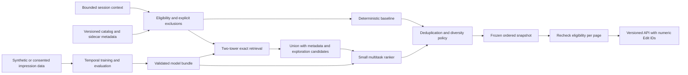

# Recommendation research and backend architecture

Status: **RESEARCH HANDOFF to Antigravity (Linux); not implemented**. Research date: 2026-10-16.
Companion contract: [API_PROPOSAL.md](API_PROPOSAL.md).

## Evidence labels and scope

- **OBSERVED**: directly inspected repository/runtime evidence, or explicitly identified published evidence.
- **INFERRED**: interpretation supported by observations, with uncertainty retained.
- **PROPOSED**: Lolixco design choice, not a claim about YouTube internals.
- **UNKNOWN**: not established by these experiments or sources.

This is a bounded, unauthenticated desktop study of one homepage and one public watch URL. It is not an audit of YouTube's production algorithm. No account, personal browser profile, credentials, private API contract, response body, or request body was inspected. No YouTube data is proposed as a training dataset. REA managed browser access was approved; passive CDP attachment remains unverified and was not retried.

## Git and catalog baseline — OBSERVED

Research was prepared on `research/recommendation-architecture` at `9780f62145ec4adb618ea2526cb0bd8707d8aeb1`. At handoff, a read-only remote query confirmed upstream `main` at `174d01a89d1f83f47f4279b7e62ca2babdb1f294`. The research branch was not rebased, advanced or pushed. These two research documents remain uncommitted; there is no research-document commit. Existing local work was preserved and excluded from the transfer. Catalog observations below describe the older research baseline; Antigravity must compare them with the newer main before implementation.

[`src/data/edits.ts`](../../../src/data/edits.ts) defines numeric IDs 0–16 and fields `title`, `category`, `tags`, `description`, `creator`, `poster`, `source`, `duration`, `trending`. Six categories cycle through 17 demo items. Every creator label is `Lolixco demo`; every card deliberately uses the same motion-study video. There are no authoritative publication timestamps, stable creator IDs, impressions, or watch histories. `duration` is display text. `trending` is a fixture flag, not measured popularity. The existing `New` filter is not evidence of publication-date ordering.

**INFERRED:** this catalog is enough for contract and policy tests, but not for demonstrating learned relevance, freshness, creator fairness, or engagement gains. Shared source URLs must not collapse the 17 intentional editorial fixtures. Antigravity's discovery/search/loading changes are not assumed present and must be coordinated separately.

## REA experiment record — OBSERVED

Actual tool: `mcp__rea__capture_browser_scenario`. All calls used `browser.mode="launch"`, the installed Chrome executable, `headless=true`, viewport 1440×1000, locale `en-US`, and fresh provider-managed browser state. Returned browser: Chromium 155.0.8059.40. Each returned `cleanup="terminated-owned-process"`. No personal session was attached.

Capture selected accessibility snapshots, URLs, screenshots, and network/page-error events. Network options were `header_values=false`, `request_body=false`, `response_body=false`; storage and raw DOM/script capture were not requested for this public-site study. Accessibility trees provide rendered semantic structure, not complete DOM/layout measurements. Screenshots were visually reviewed.

| Run | Actual actions and result | Evidence ID |
| --- | --- | --- |
| H: homepage | Open `https://www.youtube.com/`; wait for visible CSS `body` (15 s limit); wait 3 s; final accessibility/URL/screenshot. Complete. | `ev_5f7a24dbaf38f54e2c51f6ecb15091c5483d06baf346469dd0458b39778004db` |
| W: watch page | Open `https://www.youtube.com/watch?v=jNQXAC9IVRw`; wait for body; wait 3 s; press `End` on body; wait 2 s. Accessibility/URL after every step, final screenshot. Complete, but End sought the player rather than proving a scroll. | `ev_dab7efa6a0106b252016b74edfcf977cff131a35a12df2c92838223ae95a0fc1` |
| P: corrected pagination probe | Same watch URL; planned body wait, 3 s wait, click `h1`, `Control+End` on body, 2 s wait; screenshots/accessibility after steps. Body action timed out after 15000 ms; later actions cancelled. Incomplete. No pagination conclusion. | `ev_cb705c292d128451afbbf61daa61a12f017c91e1ae6e894562ef0a87affb2d36` |

`mcp__rea__export_evidence_bundle` succeeded with `overwrite=false`: 4 records, 5,757,056 bytes. The fourth record is the earlier local Lolixco smoke test. Raw evidence and reviewed screenshots remain local and are excluded from this portable handoff, along with machine-specific paths/configuration. This document retains sanitized findings and evidence IDs; raw network URL parameters are not reproduced. Independent artifact reinspection requires a separate sanitized evidence export or rerun. The export's zero top-level unknown records does **not** override run P's incomplete status or the unknowns below.

### Findings

| Topic | Classification and finding | Limitation / design implication |
| --- | --- | --- |
| Home | **OBSERVED H:** search/navigation/sign-in UI and the heading “Try searching to get started”; no recommendation cards. Screenshot location label was IN. | This one fresh guest session cannot establish universal guest-home behavior. The actual watch-history setting was not inspected. |
| Watch recommendations | **OBSERVED W:** after settling, 20 recommendation headings with title links, creator labels, durations, view counts, relative ages and More actions controls. Screenshot shows a right-hand list beside the player. | Accessibility can include offscreen nodes; 20 is a captured list size, not a guaranteed server page size. Some metadata can be absent. |
| Up Next | **OBSERVED W:** End advanced playback to about 0:18/0:19; an Up Next countdown and Cancel/Play Now appeared. | Automatic navigation was not tested. Do not equate the overlay selection with the first sidebar item. |
| Loading | **OBSERVED W:** initial capture had a player shell; the later capture included title, creator and recommendation metadata. | **INFERRED:** progressive population occurred. Exact paint timing and the recommendation service responsible are **UNKNOWN**. |
| Freshness | **OBSERVED W:** recommendation age labels ranged from hours through months and years, including 12 years. | Mixed ages show that this list was not solely newest-first. Freshness weights and publication timestamps are **UNKNOWN**. |
| Diversity | **OBSERVED W:** multiple creator labels and varied titles/durations. **INFERRED:** titles suggest several content topics. | Creator identity, category taxonomy, quotas and actual content quality were not verified; one label was `--`. |
| Pagination | **UNKNOWN:** first keypress sought playback; corrected probe failed before scrolling. | No evidence of a continuation token, infinite-loading trigger, batch size, exhaustion behavior, or deduplication guarantee. |
| Feedback | **OBSERVED W:** More actions controls. | Their menus were not opened; guest availability of individual feedback actions is **UNKNOWN**. |

Network metadata: H retained 413 events, W 574, P 551; all reported zero dropped events. These are lifecycle events, not unique request counts. H recorded 94 fetch requests, 4 XHR, 4 image; W recorded 112 fetch, 13 XHR, 22 image. H had one failed fetch event; W five; P three. No page-error events appeared. Failure causes and their effect on recommendations were not established. Responses, completions and failures can refer to the same transaction. REA explicitly warns that event order is observer receipt order, not causality; initiator stacks were unavailable. No private endpoint or payload analysis was performed.

### Published product context — OBSERVED in documentation

YouTube's public help says Home primarily uses watch history, while the current video is the main signal for suggesting the next video. It also describes likes, dislikes, feedback and satisfaction surveys. It documents a reduced homepage when watch history is off and there is no significant prior history. That is consistent with H, but does not prove H's underlying settings. [YouTube Help](https://support.google.com/youtube/answer/16089387?hl=en-GB).

## Published recommendation research

These are published designs and results, not proof of the current production stack. Source access was checked on 2026-10-16.

| Source and reading scope | Published finding — OBSERVED | Lolixco decision — PROPOSED |
| --- | --- | --- |
| Covington, Adams, Sargin, **Deep Neural Networks for YouTube Recommendations**, RecSys 2016, §§2–4. [Official publication](https://research.google/pubs/deep-neural-networks-for-youtube-recommendations/), [paper text mirror](https://www.researchgate.net/publication/307573656_Deep_Neural_Networks_for_YouTube_Recommendations), [DOI](https://doi.org/10.1145/2959100.2959190). | Separate candidate generation and ranking; averaged history embeddings; sampled classification for large catalogs; temporal context avoids future leakage. Example age addresses training-window bias and is distinct from video age. Ranking weights positive impressions by watch time and negatives by one; learned odds approximate expected watch time under stated assumptions. Offline gains need not match live gains. Official PDF endpoints failed in this session, so the original paper's mirrored text was used, not a third-party tutorial. | Separate retrieval and ranking interfaces, chronological evaluation and watch-oriented labels. Do not copy industrial dimensions, demographics, infrastructure or claim this reproduces YouTube. |
| Yi et al., **Sampling-Bias-Corrected Neural Modeling for Large Corpus Item Recommendations**, RecSys 2019. [Full paper](https://storage.googleapis.com/gweb-research2023-media/pubtools/5716.pdf), especially §§1–3. | Content-aware two-tower retrieval; skewed in-batch negatives bias training; sampling-probability correction adjusts logits. | Content features enable unseen items. Begin with full-catalog softmax on the small synthetic catalog; consider corrected sampling only when measured cost requires it. |
| Zhao et al., **Recommending What Video to Watch Next: A Multitask Ranking System**, RecSys 2019. [Official abstract](https://research.google/pubs/recommending-what-video-to-watch-next-a-multitask-ranking-system/); abstract reviewed. | Multiple competing objectives and selection bias motivate multitask ranking and soft parameter sharing. | Use a small shared MLP with watch-time and completion outputs first; defer mixture-of-experts complexity. |
| Krichene and Rendle, **On Sampled Metrics for Item Recommendation**, KDD 2020. [Official abstract](https://research.google/pubs/on-sampled-metrics-for-item-recommendation/); abstract reviewed. | Sampled ranking metrics can be inconsistent with full-catalog metrics. | Evaluate against the full eligible demonstration catalog; report retrieval and final ranking separately. |
| Kang and McAuley, **Self-Attentive Sequential Recommendation**, ICDM 2018. [Paper record/abstract](https://arxiv.org/abs/1808.09781). | Attention models relevant prior interactions in a sequence. | Keep history order and timestamps in data; defer a sequential attention model until the pooled-history baseline has adequate data and a measured limitation. |
| Huang, **Revisiting Self-Attentive Sequential Recommendation Beyond the LLM Paradigm**, arXiv 2504.09596v2, revised September 2026. [Versioned abstract](https://arxiv.org/abs/2504.09596v2). | Conceptual discussion of personalization, item semantics and evaluation limitations; explicitly not a new model. | Treat as a recent evaluation caution, not evidence that a particular model improves Lolixco. |

## Proposed system

Everything in the remainder is **PROPOSED**, unless explicitly marked otherwise. No backend, training job or dependency installation is included in this change.

### Deterministic baseline and policy

Start with all eligible items for the 17-item catalog. Normalize category/tag matching with Unicode normalization, case folding, leading hashtag removal and deduplication. Tags are soft relevance hints unless explicitly submitted as hard filters. Search remains a separate frontend-owned capability.

For an item, use `score = 0.40*C + 0.30*T + 0.15*F + 0.15*Q`, each term in [0,1]. C is the normalized context mass assigned to the candidate category; T is tag overlap with the context profile; F is freshness; Q is smoothed capped-watch quality. Context combines current-video features (weight 2) and the last 50 valid history entries with seven-day exponential half-life, then normalizes. Empty context sets C=T=0. For n finalized prior impressions, Q = (sum of budget-normalized watch targets + 10*0.5)/(n+10), using only data preceding the request. Q defaults to 0.5 without supported measurements; do not derive it from `trending`. The prior strength 10 and prior mean 0.5 are tunable demonstration defaults, not measured statistics. Define tag overlap as weighted matched profile-tag mass divided by total profile-tag mass; empty profile gives zero.

Freshness is `F = 2^(-age_days / half_life_days)`, default half-life 7 days; weight and half-life are server configuration. Unknown timestamp gives F=0 plus a missingness flag; future publication is ineligible until its time. Never infer age from ID order. Equal scores break by numeric ID ascending. Freeze `as_of`, catalog, policy and model versions for a request snapshot. Determinism means identical context and versions at the same as-of time produce the same ordered IDs, not identical request identifiers.

For cold users without a current item, round-robin eligible categories in sorted category order, taking each category's baseline-sorted items. A category filter disables this cross-category round-robin. Returning a useful demo list is preferable to an empty guest feed for Lolixco; this is a product choice, not a copied YouTube behavior.

Hard eligibility precedes ranking and is rechecked before every response: published/playable, approved visibility/status, allowed category/tags, not explicitly excluded, not current item, not session-suppressed creator/item. Unknown production eligibility is denied; demo fixtures require an explicit demo-catalog allowlist. Seen items receive a soft repeat penalty in neural features; only explicit exclusions are hard. Deduplicate by numeric Edit ID. A future authoritative `canonical_content_id` can remove genuine reuploads; never use shared demo media URLs as that identity.

Greedily select with a default creator cap of 2 per consecutive 10 positions across the whole snapshot, including page boundaries. Preserve relevance order within the feasible set. If underfilled, relax only the creator cap incrementally and report `creator_cap_relaxed`; never relax eligibility or exclusions. This is necessary for the single-creator demo. Use stable creator IDs in a sidecar, not display-name equality. Category coverage and creator concentration are measured, not assumed from varied titles.

### Neural candidate generation

Use PyTorch float32, 64-dimensional query/item vectors, and small 128→64 MLP towers. Item inputs: learned ID embedding with an OOV bucket, category embedding, mean tag embeddings, creator embedding with OOV, normalized duration and timestamp-missing flag. Keep stable numeric external IDs mapped to dense internal rows; ID zero is not padding. A separate padding index and masks are required.

The query tower pools preceding item representations with recency weighting, current item and surface; empty history uses explicit empty-history features. No demographic inference, persistent identity or language model is needed. Apply ID dropout during training so content features carry cold-item signal. New creators share an OOV embedding plus category/tags; item vectors are generated at catalog publication.

Train next-positive-item cross-entropy over the full eligible training catalog initially; cap per-session contributions. Negatives in this retrieval objective are contrastive alternatives, not asserted dislikes. For serving, exact matrix multiplication is sufficient at the proposed 10,000-item benchmark scale. Union the top 160 retrieval candidates, up to 20 metadata candidates and up to 20 eligible fresh/new-creator candidates; deduplicate to at most 200. Fill shortages from baseline order. Exploration candidates use a stable hash of session context, UTC day and ID, so daily exploration is repeatable. No ANN database initially.

### Ranking and watch-time objectives

Rank at most 200 candidates with a 128→64 shared MLP using query/item vectors, elementwise interaction, category/tag match, age/missingness, prior exposure, duration and smoothed historical quality. Two outputs: expected **60-second-budget-normalized watch target** f_hat in [0,1], and completion probability p_hat. With authoritative duration d > 0 seconds and unique watched time w, define y_seconds = min(w, d, 60) and f_target = y_seconds / 60. Train f_hat against f_target with squared error; train completion probability with binary cross-entropy, where completion means at least 90% unique coverage of the full duration. This f_target is not the per-video completion fraction w/d. Clamp f_hat at serving to min(d,60)/60 when d is known. Rank utility is **0.8*f_hat + 0.2*p_hat**. Never divide f_hat by 60 again. If seconds are needed for reporting, predicted_seconds = 60*f_hat. For a fully watched 12-second item, f_target=0.2; with p_hat=1 and perfect watch prediction, utility=0.36. For a fully watched 60-second item, f_target=1 and utility=1.

Before diversity selection, use neural_score = (1-lambda_f)*utility + lambda_f*F with configurable lambda_f in [0,1], default 0.15, and the same freshness F defined above. Calibrate and evaluate by duration bucket; the seconds-oriented target deliberately favors more watched seconds and can favor longer videos. Whether to instead optimize per-video watch fraction is an unresolved product choice; it requires changing the target definition and reevaluating duration bias, not silently renormalizing the serving score. These weights are experiment defaults, not validated optimals.

Only a finalized exposed impression with no play after the defined attribution window is a zero-watch label; an unshown item is not a zero. Missing/censored telemetry is excluded from supervised ranker labels. Negative feedback immediately suppresses future serving; its sparse signal should not be treated as universal dislike ground truth. Future satisfaction feedback can add a head after its collection semantics are approved.

Count unique played intervals per playback, clipped to authoritative duration, then cap contribution per impression/session/item. A–B looping or seek jumps must not multiply training reward. Do not modify the current player to achieve this mission. Accurate interval collection is a future coordinated instrumentation task; until then, synthetic labels only. Autoplay, position and selection policy confound observations: log them for evaluation, never assert causal improvement from observational watch time.

### Cold start and fallback

| Case | Serving behavior |
| --- | --- |
| No history | Deterministic category-balanced baseline; current-item similarity for Up Next. |
| Unseen item/creator | Content tower and OOV embeddings; controlled exploration, no fabricated engagement prior. |
| Missing dates/duration | Explicit missing features; no freshness bonus; omit duration-dependent training labels until duration is authoritative. |
| Missing, incompatible or nonfinite model | `auto` falls back to baseline with reason; explicitly requested neural mode returns unavailable. |
| No eligible candidates | Successful empty response with no cursor; never fill with excluded content. |

## Synthetic data, evaluation and CPU operation

Keep the real 17-item fixture catalog separate from a seeded synthetic dataset: proposed 5,000 edits, 200 creators, 2,000 synthetic users and 100,000 impressions over 30 simulated days. Generate latent interests, creator/category imbalance, new publications, noisy watch fractions, skips, sparse feedback and loops. Vary exposure policies and random seeds. Do not train and test solely against the baseline scoring formula; that would reward reproducing the simulator rather than recommendation quality.

Split by global time (days 1–20 training, 21–25 validation, 26–30 test), preserving within-session causal history. Feature aggregates and vocabularies are fit only on prior data; no future popularity, user actions or publication inventory. Add held-out creator/item and empty-history cohorts. Training output includes data seed/hash, cutoff, schema, vocabularies, configuration, weights, metrics and catalog compatibility. Synthetic performance demonstrates mechanics only; real effectiveness remains **UNKNOWN**.

Evaluate candidate Recall@200 before ranking; NDCG@10 and Recall@10 after policy. Define a relevant next event as at least 50% unique coverage without negative feedback; log sensitivity to that threshold. Use the full eligible catalog available at the event time. Exclude requests with no evaluable positive from relevance denominators and report their count. Compare fixed baseline, retrieval-only and full system on identical requests; bootstrap uncertainty by session. Also report catalog coverage, distinct stable creators@10, maximum creator share, mean/quantiles of age, repeat rate, empty rate, cold-start metrics and duration-bucket calibration/MAE. All quality metrics are **NOT MEASURED** in this mission.

Proposed engineering gates: numeric IDs round-trip including zero; zero prohibited/duplicate items; deterministic baseline; stable pagination; model failure fallback; no NaNs. Benchmark a declared CPU/Linux environment (record hardware, runtime and thread settings) at 10,000 catalog items and 200 ranking candidates, warm and cold runs separately. Initial goals, not measured guarantees: p95 baseline HTTP latency below 50 ms and neural below 100 ms at one concurrent request; measure throughput and memory before setting concurrency. Serving uses `eval()` and inference mode, bounded torch threads, precomputed item vectors and one model load per process. No training in request handlers. Swap validated bundles atomically; retain a known-good baseline and model for rollback.

## Dependencies, cost and staged implementation

Proposed Python 3.12 virtual environment, FastAPI, Pydantic 2, Uvicorn, NumPy and CPU PyTorch; pytest/httpx for future tests. Verify compatible released versions and Linux CPU wheels, then create a locked environment during implementation. No versions or Python installation have been verified/installed here. Use PyTorch's official platform selector and FastAPI's ASGI guidance rather than guessing accelerator packages. [PyTorch installation](https://pytorch.org/get-started/locally/), [FastAPI serving](https://fastapi.tiangolo.com/deployment/manually/).

Use JSON catalog snapshots plus SQLite (Python standard library) for local events and bounded cursor state. No Redis, Kafka, vector database, GPU, cloud account, pretrained encoder or paid API is needed for the demonstration. A 10,000×64 float32 item matrix is 2.56 MB (decimal); 100,000 rows is 25.6 MB, excluding model, runtime, catalog and request memory. Torch installation size and process RAM must be measured; reserve roughly 2–4 GiB RAM and several GiB disk as a planning allowance, not an observed requirement. Synthetic event storage scales with record size and indexes. Local execution has no cloud/API charge; electricity, disk and engineering time remain costs. Any hosted plan needs a separate workload benchmark and current vendor quote.

After review, implement in these independently reviewable stages:

1. Contracts, catalog adapter/sidecar and deterministic eligibility/baseline; tests for ID 0, unknown dates, exclusions, shared demo source, single creator and empty results.
2. Frozen pagination, health/readiness, explicit fallback and model manifest checks; contract examples as tests. Coordinate frontend integration with Antigravity without changing its discovery/search work unilaterally.
3. Seeded synthetic generator, temporal feature pipeline and evaluation report. Test leakage and cold-start cohorts before training.
4. Train two towers and small ranker on CPU; benchmark against baseline and publish failures as well as gains. Keep neural explicitly opt-in until review promotes a validated bundle for auto mode.
5. Separately approve real telemetry, privacy/retention, instrumentation and any online experiment. Synthetic results do not authorize production rollout.

Planning estimate: roughly 5–10 engineering days for stages 1–4 plus review, contingent on catalog/instrumentation decisions; not a delivery commitment. Real-data quality validation is additional work and cannot be estimated from this demo.

## Review risks and readiness

**Ready for design review, not implemented.** Main risks: sparse/no real data; synthetic evaluation bias; watch-duration and exposure bias; missing authoritative metadata; creator-cap relaxation in the demo; cursor memory/session management; model/catalog skew; frontend contract coordination. YouTube pagination, proprietary signals, exact freshness/diversity rules and production model are **UNKNOWN**. None is a prerequisite for an independent Lolixco baseline.

Application source, setup report, dependencies and configuration remain unchanged. No commit, push, pull request, merge, deployment, backend or model training was performed. Antigravity (Linux) owns implementation going forward. Next action is its review against the newer main baseline and resolution of product choices; Codex recommendation work stops with this handoff.
